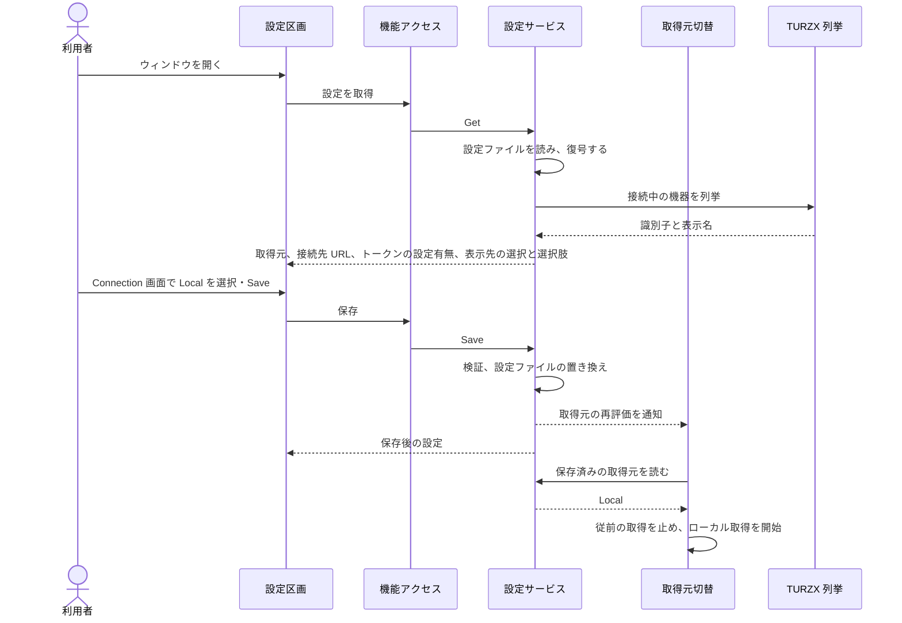

# UCP-2. 入力した設定を検証・保存し、実行中の処理へ反映する

適用条件と関与コンテナは [アーキテクチャの一覧](../architecture.md#patterns) を参照します。パターンからの逸脱は対象 UC ごとに本書へ記録します。図は主成功系列を役割名で示します。

| 役割 | 責務 | 実装パス（段階4完了時に記入） |
| --- | --- | --- |
| 設定区画 | 取得元と表示先、選択肢、表示設定を表示する。表示先とスタイルは独立して手動選択し、サービス表示の操作は[対象シナリオ](../usecases/利用状況をUSBディスプレイに表示する/scenarios/3.5インチでサービスごとの利用枠を順番に表示する.md)に従う。`Cycle`・`Cycle time`・`Away time`は`Settings`画面で編集する。表示設定は保存成功後に反映し、失敗したら選択を戻してエラーを表示する。取得元と接続先の入力は`Connection`画面で保存まで保持し、`Save`で保存する。Hub選択時だけ接続先の入力を表示し、認証トークンは入力だけを受けて表示しない | `frontend/src/usecases/configure-hub/ConfigureHub.tsx`、`frontend/src/usecases/configure-hub/SettingsDraft.tsx`、`frontend/src/usecases/show-usage/UsagePreview.tsx`、`frontend/src/routes/settings.tsx`、`frontend/src/app/Shell.tsx` |
| 機能アクセス | 本体の設定サービスを呼び出し、取得結果と保存結果を画面の状態へ反映する | `frontend/src/features/settings/queries.ts` |
| 設定サービス | 取得元、表示先、スタイル、表示設定を検証し、1操作を1回のファイル置き換えで確定する。サービス設定は取得元別に保持し、個別枠の選択から独立させる。表示設定の保存成功を描画へ通知し、ページと巡回期限への反映は対象シナリオに従う。スタイルの識別と表示先との適合性は[共通契約](../architecture.md#style-contract)と[設計上の制約](../architecture.md#design-constraints)に従う。Hub選択時は接続先URLと認証トークンを1組でDPAPIにより暗号化し、画面へは設定有無だけを返す。取得元または接続設定が変わったときだけ取得元の再評価を通知し、表示設定の変更では取得を止めない | `internal/settings/service.go`、`internal/settings/dpapi_windows.go` |
| 取得元切替 | 保存済みの取得元を読み、従前の取得処理を停止して選択した取得処理を起動する。ローカル取得は同梱の tokscale の結果を表示用の最新状態へ変換する | `main.go`、`internal/localusage/reader.go`、`internal/hub/receiver.go` |
| TURZX 列挙 | 対応する接続機器を列挙し、機器の識別子と識別できる表示名を返す。機種の判別は通信に使い、スタイルを自動選択しない。未接続の明示選択は保持する | `internal/turzx/devices.go`、`internal/turzx/devices_windows.go` |

- 整合性: 状態更新の主体は設定サービス / 結果確定点は設定ファイルの置き換えの成功 / 障害時は既存の設定ファイルと画面上の入力を保持し、保存しなかったことを示す。表示設定の保存に失敗した場合は画像、ページ、巡回期限も変更しない / 境界は、同時に届いた保存要求を1件ずつ処理すること。

設定に依存する処理への反映: 取得元または接続設定の保存後に取得処理を切り替える。表示設定は保存の成功を通知して描画と送信へ反映し、設定の世代が異なる画像を変更後の表示先へ送らない。機器とスタイルが不適合な状態でも両方の選択は保持し、USB送信だけを止める。保存形式は[データ設計](data.md)で管理する。

表示候補の導出: `internal/turzx/profiles.go`で機器識別子を対応描画寸法と通信方式に解決する。設定サービスは保存した表示先、またはAutomaticの最初の機器を同じ規則で解決し、`Profile.Supports`による寸法の完全一致から`View.compatibleThemeIDs`を導出する。`View.themes`には全メタデータを返す。新しいスタイルの選択は保存時点の機器一覧で再検証する。候補の取得と警告の更新では保存や巡回状態を変更しない。

モックの境界: 仕様確認用の固定表とメモリ内設定は実処理経路から削除し、設定は[保存形式](data.md)に従って読み書きする。取得失敗から固定値へ切り替える経路はない。

UC 固有の逸脱: なし
